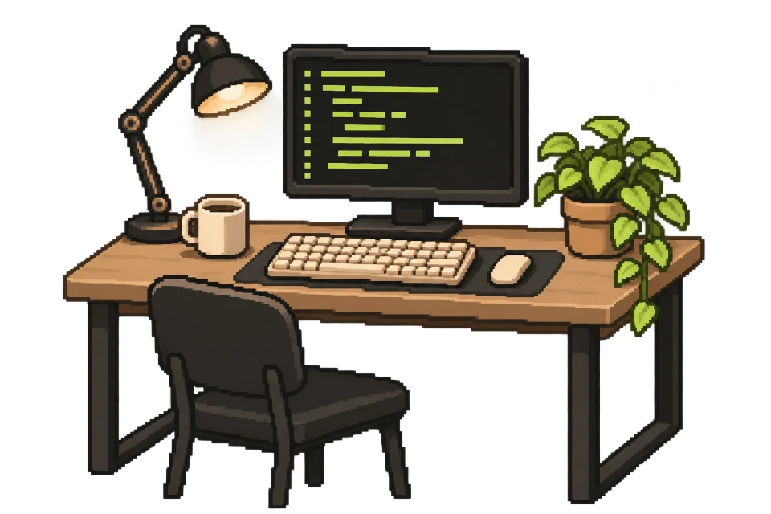

# Thimira Niranjaya — Developer Portfolio

The frontend for [thimira.tech](https://www.thimira.tech), showcasing my work in backend engineering, cloud infrastructure, and AI. I'm an Information Systems undergraduate at Sabaragamuwa University of Sri Lanka, seeking a software engineering internship.

Built with React, an ink-black and warm-sand palette, electric-lime highlights, and an original animated pixel workspace.

**[Live portfolio](https://www.thimira.tech)** · **[Selected work](#selected-work)** · **[Run locally](#run-locally)** · **[Design system](DESIGN.md)**

<p align="center">
  
</p>

## What’s inside

- **Project case studies:** selected work with the problem, my contribution, outcome, architecture decisions, source links, and demonstrations.
- **Experience and evidence:** education, engineering roles, awards, technical writing, and linked credentials.
- **Responsive navigation:** current-section tracking, a résumé chooser, and a mobile menu with keyboard support.
- **Current résumés:** separate software engineering and DevOps PDFs, hosted with the site.
- **GreenOps preview:** an architecture diagram with the original dashboard screenshot available alongside it.
- **Light and dark themes:** shared color tokens and a saved theme preference.
- **Gentle motion:** animated monitor code, coffee steam, subtle background graphics, and spring-based pointer depth. The desk stays grounded at rest.
- **Motion controls:** shared pause controls in the header and hero, reduced-motion support, hidden-tab suspension, and offscreen suspension for the workspace.
- **Local assets:** self-hosted fonts, responsive project screenshots, and explicit image dimensions.
- **Contact:** direct email and social links, copy controls, and a Formspree message form.

## Selected work

Each project links to its own implementation; its engineering story is presented in the portfolio.

| Project | Focus | Explore |
| --- | --- | --- |
| **NearU** | Real-time campus ride sharing with .NET, SignalR, Redis, and PostGIS | [Repositories](https://github.com/Nearu-Project-SUSL) · [Live demo](https://nearusab.me) |
| **GridWalk AI** | Multi-agent fault analysis and recovery planning for microgrids | [Source](https://github.com/Dileesha001/GridWalk-AI) · [Demonstration](https://youtu.be/gPm9pV6GcR4) |
| **GreenOps Intelligence Hub** | Cloud telemetry, static code analysis, and software carbon intensity estimates | [Source](https://github.com/thimira20011/GreenOps-Intelligence-Hub) |
| **AyurFlow** | Member A: Go backend, staff authentication, authorization, auditing, and DevOps for a clinic management system in development | [Source](https://github.com/thimira20011/AyurFlow) |

## Technology

| Area | Implementation |
| --- | --- |
| UI | React 18, JavaScript, Vite 8 |
| Styling | CSS custom properties, custom CSS, Tailwind CSS 3 |
| Animation | Motion for React, CSS animations, Web Animations API |
| Typography | Self-hosted Bricolage Grotesque and Manrope |
| Icons | Lucide React and Heroicons |
| Contact | Formspree |
| Analytics | Vercel Web Analytics |
| Tests | Vitest 5, jsdom, and React DOM test utilities |

## Run locally

Install Git, Node.js 22.22.2 or newer, and npm. Local development has been verified with Node.js 22.23.4 and npm 11.

```sh
git clone https://github.com/thimira20011/personal-portfolio.git
cd personal-portfolio
npm ci
npm start
```

Open [localhost:3000](http://localhost:3000). The development server reloads when source files change. The current app requires no `.env` file to start.

### Commands

| Command | Purpose |
| --- | --- |
| `npm start` | Start the development server |
| `npm test` | Run the interaction tests once |
| `npm run test:watch` | Watch tests while developing |
| `npm run build` | Create an optimized production build in `build/` |
| `npm run preview` | Preview the production build at localhost:4173 |

The tests cover navigation, both résumé links and chooser dismissal, project filtering, theme persistence, architecture explanations, contact errors, shared motion controls, reduced-motion preferences, and visibility handling.

## Project structure

```text
public/
  certificates/            Linked certificate PDFs
  cv/                      Software engineering and DevOps résumés
  fonts/                   Self-hosted fonts, licenses, and origins
  images/                  Portrait, project screenshots, and pixel artwork
    responsive/            Smaller screenshot and portrait variants
src/
  App.jsx                  Theme, shared pause state, and page composition
  components/
    PortfolioSections.jsx  Navigation, hero, projects, about, and credentials
    SupportingSections.jsx Experience, awards, writing, contact, and footer
    PixelWorkspace.jsx     Animated monitor, steam, and pointer interaction
    AmbientBackground.jsx  Decorative pixel layers and background graphics
  data/
    portfolio.js           Personal content, projects, credentials, and links
    projectStories.js      Selected-project narratives and architecture flows
    imageProps.js          Intrinsic image dimensions and responsive sources
  hooks/
    useReveal.js           Once-only viewport entrances
  index.css                Theme tokens, typography, layout, and components
  lively.css               Animation and interaction styles
index.html                 Page metadata and application entry
vite.config.mjs            Build, local server, and test configuration
```

## Updating the portfolio

| Change | Where to edit |
| --- | --- |
| Name, biography, résumé, social links, projects, and credentials | [src/data/portfolio.js](src/data/portfolio.js) |
| Selected-project contributions, outcomes, and architecture explanations | [src/data/projectStories.js](src/data/projectStories.js) |
| Featured project selection and primary section layouts | [src/components/PortfolioSections.jsx](src/components/PortfolioSections.jsx) |
| Contact form endpoint and submission handling | [src/components/SupportingSections.jsx](src/components/SupportingSections.jsx) |
| Colors, type, spacing, and responsive layout | [src/index.css](src/index.css) |
| Animation timing, hover feedback, and reduced-motion styles | [src/lively.css](src/lively.css) |
| Page title, description, canonical URL, and social previews | [index.html](index.html) |

When replacing a portrait or project image, update its dimensions in [imageProps.js](src/data/imageProps.js) and provide the corresponding variants in `public/images/responsive/`. Certificate PDFs live in `public/certificates/` and are referenced from the content data.

Replace the two résumés in `public/cv/` and update the labels, file sizes, and URLs in `portfolioData.resumes` when publishing a new version. The software engineering résumé is the main hero action; the DevOps version is linked below it, and both appear in navigation.

For a personal adaptation, update the contact details and replace the Formspree endpoint with your own. Keep project contributions and outcomes tied to evidence in their implementations.

## Production build

```sh
npm run build
```

Serve the generated `build/` directory with a static hosting provider. Configure the build command as `npm run build` and the output directory as `build`.

The included `vercel.json` specifies this build command and output directory for the existing Vercel deployment.

The current site uses a root-domain asset layout. For a deployment under a repository subpath, set Vite’s `base` option and review the few root-relative asset references together. An optional `npm run deploy` script is included: it builds and publishes `build/` using `gh-pages`. `BUILD_PATH` can override the output directory for local checks without replacing an existing build.

The deprecated Create React App toolchain was replaced with Vite to resolve its remaining dependency audit findings. Run `npm audit` to check the current dependency tree against the latest advisory database.

## Design and asset records

- [DESIGN.md](DESIGN.md) — current color, typography, layout, component, and motion system.
- [Refinement plan](REFINEMENT_PLAN.md) and [review](REFINEMENT_REVIEW.md) — the latest implementation scope, checks, and known limits.
- [Maintenance review](MAINTENANCE_REVIEW.md) — dependency remediation, current résumés, GreenOps preview, and subsequent validation.
- [Design skill review](DESIGN_SKILLS_REVIEW.md) — installed design guidance, sharing preview, and accessible contact feedback.
- [Image provenance](public/images/README.md) — screenshot sources and the generated pixel illustration, including its recorded prompt.
- [Font origins and licenses](public/fonts/README.md) — self-hosted font sources and SIL Open Font License files.

Earlier design iterations remain documented in [REDESIGN_REVIEW.md](REDESIGN_REVIEW.md) and [DESIGN_REVIEW.md](DESIGN_REVIEW.md).
